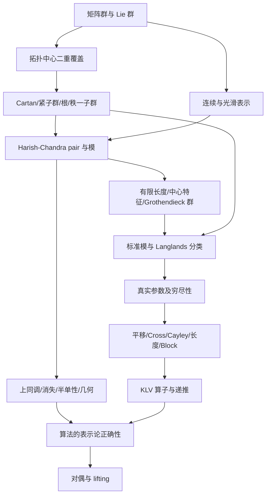

# 形式化路线图：真实的群 → 真实的表示 → KLV

项目目标是 Renard–Trapa 的 *Kazhdan–Lusztig algorithms for nonlinear groups and applications to Kazhdan–Patterson lifting*。文献键见 [REFERENCES](docs/REFERENCES.md)，逐对象的数学定义和依赖见 [DEFINITIONS](docs/DEFINITIONS.md)，实际完成情况见 [STATUS](docs/STATUS.md)。

**本文件是实施计划，不能据此推断某个 Lean 定义或定理已经完成。**

## 0. 最终要交付什么

用户指定的顺序是“先把群定义出来，表示搞出来，KLV 做出来”。因此最终的主定理必须谈论实际群的实际 Harish–Chandra 模，而非仅谈论有限标签。

固定本文允许的实群及其二重覆盖、正则无穷小特征和所需中心特征后，构造参数、标准模 `X(γ)`、不可约模 `L(γ)`、KLV 多项式，并证明

$$[L(\delta)]=\sum_\gamma M_{\gamma,\delta}[X(\gamma)],\qquad
M_{\gamma,\delta}=(-1)^{\ell(\delta)-\ell(\gamma)}P_{\gamma,\delta}(1).$$

另设组成因子矩阵

$$[X(\delta)]=\sum_\gamma m_{\gamma,\delta}[L(\gamma)],\qquad m=M^{-1}.$$

这是项目的矩阵方向约定。与每份文献的下标、横线、对偶约定之间都要建立明确对应。

随后完成 block 对偶与 Kazhdan–Patterson lifting，并以 GL(4,R) 的可约 lifting 为完整应用。只验证整数等式不算完成表示论应用。

## 1. 范围与不可省略的假设

RT05 Part I 从 Harish–Chandra 类中的线性群、交换 Cartan 和指定的二重覆盖出发；还使用 Definition 6.3 的 genuine-cover 根条件与 Hypothesis 6.15 的最低 K-type 重数一条件。不能把后者直接藏入“任意实约化群”的名字中。

必须区分四个性质：

- 代数群意义的 simply connected；
- Lie 群的拓扑 simply connected；
- 一个中心二重扩张是否 split；
- 一个 Lie 群是否有忠实有限维连续表示，即是否 linear。

第一实现家族为 GL(n,R) 及本文指定的非线性覆盖；SL(2,R) 的覆盖作为基础测试。另以 Mp(4,R) 检验两种根长与非整墙机制。一般秩和 Part I 的范围不因这些测试而缩小。数学参数允许复数；可执行后端先使用精确有理数据，推广到一般参数的定理单列。

## 2. 依赖顺序

Laurent 多项式、有限自由模等通用工具可以并行准备，但不能取代 G、R、S 阶段的交付。

## G0. 实际的线性群与 Lie 理论

**定义对象：** GL(n,R)、SL(n,R)、Sp(2n,R)、U(p,q)；子群、连通分支、Lie 代数、复化、Ad；Harish–Chandra 类、线性性；Cartan involution、紧子群 K、Cartan decomposition。

**实现路径：** 优先复用 mathlib 的矩阵群、有限维流形和 Lie 代数。先有实际矩阵群，再证明它们满足所需结构条件。给一般实群提供性质明确的接口，但接口实例必须由构造和证明给出。

**验收：** 不仅能写一个 `G : Type` 加一个 `Group G`，而且有至少一个一般秩矩阵群实例、与矩阵 Lie 代数的比较、明确的 Cartan involution 和紧子群。一般 Harish–Chandra 类的定义与采用的文献逐项匹配。

**参考：** Vgr §0.1；Knapp；KV Definition 4.29；AVLT §§2–4（后者主体范围是线性代数群，不能直接推广其全部定理）。

## G1. 覆盖群真的构造出来

**定义对象：** 中心扩张 `1 → {1,z} → E → G → 1`；代数、连续、光滑 splitting；覆盖映射、局部平凡化、路径提升；Lie 群覆盖；子群逆像；等价的覆盖；非线性；metaplectic root；RT05 genuine cover。

先完成代数核与纤维性质，再加入 topology 和 smoothness。离散核的代数满同态本身不等于覆盖映射。

**具体构造线路：**

1. 用 SL(2,R) 在上半平面的作用及 automorphy factor 的全纯平方根，或路径空间商，构造非平凡二重覆盖；证明群律、拓扑、二点纤维与非平凡性。
2. 对 GL(n,R) 的恒等分支，按基本群/路径提升构造目标二重覆盖；再处理非连通分支的延拓和乘法。明确采用哪种覆盖，核对其在紧子群及秩一子群上的限制。
3. 构造覆盖中的 K、H、M、A、N，并证明与基群 Lie 代数的比较。
4. 扩展到 Mp(2n,R)、U(p,q) 和一般框架；检查 Levi/centralizer 所需的封闭性。

**两个禁止的捷径：**极分解通常是微分同胚，不是直积群同构；不能按分量相乘来定义覆盖。也不能未经验证就把辛群 Siegel Levi 上的拉回覆盖称为本文 GL(n,R) 的非线性覆盖。

**验收：** 指定群上的一个实际非平凡 Lie 群覆盖；核、局部平凡化和群律全有证明。`AlgebraicDoubleCover` 结构本身只完成本阶段的最底层定义。

**参考：** RT05 §6、Part II 的群选择；Adams04；AT12 §§2–3（定义之间的比较另证）。

## G2. 群结构、Cartan 与根

**定义对象：** θ-stable Cartan subalgebra、其 centralizer H、H=T A 的适当分解、真实与抽象 Weyl 群；根与余根、正根、实/虚/复根、compact/noncompact 虚根；秩一同态、mα、metaplectic root；parabolic、Levi 和 nilradical。

**核心义务：** covered Cartan 可不交换；其表示未必一维。根分类从 θ 和根空间的实际作用推出，不从一个枚举标签直接假定。分别证明 normalizer quotient 与 root-system Weyl group 的比较；记录复杂根、非连通分支和覆盖核的行为。

**验收：** 从具体群的 Cartan 数据产生根数据；GL(n) 的 Cartan 家族及覆盖限制有精确模型，秩一现象与其兼容。

**参考：** RT05 §§1、5–6；Vgr；Adams04；AT12 §5。

## R0. 群表示与光滑向量

**定义对象：** 线性表示、intertwiner、同构、子表示/商、不可约；联合连续作用；光滑向量；g0 作用及复化；K-finite vectors；genuine；中心特征；必要时分布特征标。

**先证明：** 限制、拉回、直和、张量积、商的表示结构；genuine 性质的稳定性；非零 genuine 表示不能下降到 G；光滑 K-finite 向量同时受 g 与 K 作用。

**验收：** 有实际群在实际向量空间上的表示，不是标签；连续性不是“每个 π(g) 连续”而是作用映射联合连续。微分作用与原作用的连接是证明出来的。

**参考：** AVLT §2、Definition 5.11；Vgr §0；Wallach。

## R1. Harish–Chandra pair、模与范畴

**定义对象：** (g,K_C)-pair；locally algebraic K_C 作用；g 作用；Ad 相容性；K 作用微分与 g 作用限制相等；admissibility；U(g)-有限生成；有限长度；genuine Harish–Chandra 模。

**设计：** 先将一般相容 pair、(g,K)-module、admissible module、Harish–Chandra module、finite-length subcategory 分开定义。用有限维 K-stable 子空间解释微分，不强迫给纯代数 Harish–Chandra 模选取任意拓扑。

**验收：** morphisms、kernel、cokernel、exact sequence 都在实际表示范畴中定义；与 smooth K-finite 模型的比较成立。不能把 `finiteLength : Prop` 或 `classification : Prop` 当作未经展开的字段。

**参考：** AVLT Definitions 2.5、8.1；Vgr；KV；Wallach。

## R2. U(g)、无穷小特征、长度与 K0

**定义对象：** enveloping algebra 的实际作用；Z(g)；χ:Z(g)→C；exact/generalized infinitesimal character；χ-primary submodule 与投影；composition series、Jordan–Hölder multiplicity；由短正合列定义的 Grothendieck 群。

**验收：** finite-length 的 K0 以 simple classes 为基的定理；组成因子重数的良定义与可加性；广义无穷小特征分解的精确性。固定 exact central character 的类别不自动对扩张封闭。

**参考：** RT05 §§1–2；Vgr §0.3；一般有限长度阿贝尔范畴理论。

## S. 标准模、pseudocharacters 与分类

**定义对象：** 离散系列/相对离散系列、诱导数据、normalized parabolic induction、标准模、Langlands 不可约成分；pseudocharacter (H,Γ,λ) 及微分/ρ-shift/regularity 条件；K-conjugacy classes。

**关键次序：**

1. 在实际函数空间或等价的已证明模型上构造诱导表示，固定 modular-character 归一化。
2. 从 Γ、λ 构造标准模 X(γ)。
3. 证明适当正负 chamber 下唯一不可约 submodule 或 quotient；统一 RT05 §1 所用 submodule convention。
4. 证明所有 irreducibles 的参数化、参数同构判别和有限性。
5. 将标准模、不可约模的 K0 基与有限参数坐标模型联系起来。

**验收：** 一般 family 的实际标准模和不可约模；分类与参数穷尽是定理。不能通过 `structure Parameter` 的一个字段直接要求所有分类结论。

**参考：** RT05 §1；RT00 §1.2；Vgr 的 Langlands classification；Knapp/Wallach。离散系列和所需解析实现属于这个工作包，不应隐去。

## W. 平移、Cayley、cross action、block、长度

**定义对象：** 有限维最高权表示 Fμ、translation functor、整/非整墙、τ-invariant、Uα；cross action；Cayley 与逆 Cayley；parity/type I–II；非整墙需要的参数族 F；block equivalence；ordinary/integral/extended-integral length。

**必须证明：** translation 的 exactness、adjunction 或 equivalence；Cayley 的存在、取值数目、同构不变性；参数组合模型与真实操作一致；扩张整根系 θ-stable；长度差的整性与奇偶性；Hypothesis 6.15 在初始群族中的成立。

**验收：** `P_F` 的枚举正确且穷尽，真实表示生成的 block 与组合连通分量相等。特别处理 RT05 对 type I–II 的约定，不能照搬 RT00 的同名标签。

**参考：** RT05 §§2–8；RT00 §§3–5；Vgr Chapters 7–9；AT12 §7 只用于其明确适用范围。

## K1. KLV 的可执行代数部分

输入是前一阶段从真实表示构造出的有限参数数据，也允许把同一套纯代数引擎独立测试。

**定义对象：** Laurent 系数环（必要时 u=v²）；free module on P_F；Bruhat G-order；RT05 Definition 9.4 的全部 T_s 分支；bar/半线性对偶 D；规范基 Cδ；Pγδ；多项式矩阵及其逆。

**证明分解：**

- 参数操作的闭合性、偏序、良基下降；
- 整根 `(T_s+1)(T_s-u)=0` 与非整根 `T_s²=u Id` 的适用范围；
- bar 的存在、半线性、平方为一和三角性；
- 规范基存在与唯一性分别证明；
- 递推终止、输出满足刻画条件、选择无关；
- 有理精确后端与数学参数模型的比较。

RT05 Corollary 9.6 是在存在性条件下给出可计算性/唯一性。它本身不能充当整个规范基存在定理。

**验收：** verified algorithm，不是缓存文末矩阵；覆盖所有定义中的根分支。至少检查非整墙与双值 Cayley 的测试。普通 Weyl 群 KL 引擎不能冒充本阶段成果。

## K2. 算法确实计算表示重数

**定义对象：** Lie algebra cochain complex 与 H^q(u,X)；Uα(X) 的上同调；Ext；必要的 vanishing/parity 与 semisimplicity；flag variety、equivariant local systems、twisted D-modules、localization、perverse sheaves、Verdier duality、intersection cohomology。

这些几何概念是完整证明的依赖工作包；不是“引用一个名字”即可算已形式化。可以选更窄的特例定理以缩小工作量，但必须证明并说明适用范围。

**目标：** RT05 Theorem 8.1 → Theorem 9.9（组合多项式与上同调多项式一致）→ Theorem 9.10（取值 1 得到 character matrix）。同时证明 m=M⁻¹，并证明 m 的条目是实际 Jordan–Hölder multiplicities。

**验收：** 最终 theorem 的签名含真实 `HCModule`、实际 `K0` 和已构造的标准模；不存在“假设 KLV 正确则 KLV 正确”的循环接口。

**参考：** RT05 §§8–9；RT00 §7；Vogan III；ABV §17；所需 localization、Riemann–Hilbert 和 decomposition theorem 的原始文献。

## D. 对偶、lifting 与完整应用

先做参数对偶及算子模同构，再由规范基唯一性得到带符号逆转置恒等式；随后在真实 K0 上解释它。

定义 Kazhdan–Patterson 的 lifting（包括正则半单集、匹配关系、transfer factor、所需分布特征标）；另定义由参数和几何构造的 Sλ。证明它们相同，保留 Theorem 12.2 中外自同构 A 的选择。

GL(4) 应用的完成标准：从真实群和标准模产生输入 → 枚举穷尽 → 运行已验证算法 → 证明 lifting 识别 → 得到一个不可约表示的 lift 分解成两个不同不可约表示。仅检查最后一个线性等式是低层证书。

**参考：** RT05 Parts II–III；Vogan IV；ABV；KP；AH97。

## 3. 里程碑验收表

| 门槛 | 数学交付 | 不能代替它的东西 |
|---|---|---|
| M0 | 可复现 Lean 工程、源码与状态清单 | 只有目录 |
| M1 | 一般矩阵群 + 实际非平凡 Lie 群覆盖实例 | 只有抽象扩张结构 |
| M2 | 实际连续表示、HC 模与范畴 | 参数标签 |
| M3 | 标准模、不可约成分、分类与 K0 基 | 把分类定理放进结构字段 |
| M4 | 与真实操作对应的有限参数和 block | 未证明穷尽的枚举 |
| M5 | KLV 递推的存在/终止/正确性 | 普通 KL 或抄表 |
| M6 | Theorems 9.9–9.10 的表示论解释 | 假设 multiplicity theorem |
| M7 | 对偶、lifting 与 GL(4) 应用 | 单独的整数矩阵证书 |

## 4. 紧接着的实施任务

先使首批代码与 proof-dependency 检查通过，再完成 G1 的 topological cover 接口和非平凡实例。然后推进微分、K-finite 与 HC compatibility。KLV 文件中尚未实现的数学定义保留在 registry，不用 `axiom`、`sorry` 或空谓词补齐目录。

每次提交同时更新完成状态与未清偿义务；对现有源码做过成功编译后，才能把文档中的相应状态升级。
